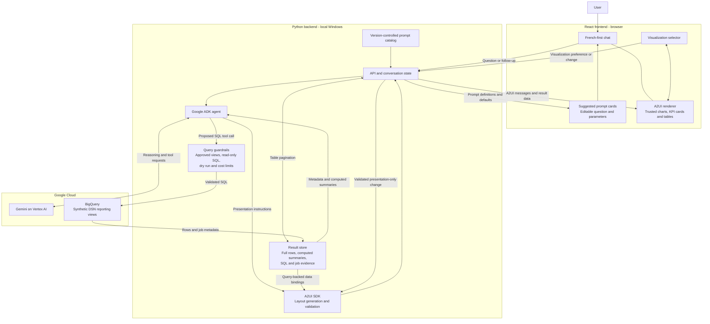

# DSN Analytics Agent

Status: design agreed on 2026-11-21. Initial local implementation is available;
live BigQuery and Vertex AI execution requires deployment configuration and ADC.

## Goal and scope

Build a local, French-first conversational analytics demo over synthetic
DSN-inspired data stored in real BigQuery. Use Google ADK and its BigQuery tools
for the agent, Gemini through Vertex AI for model access, and A2UI for
query-backed charts, KPI cards, and tables in a React client.

The demo provides descriptive analytics, not payroll advice, compliance
judgments, anomaly detection, or payroll corrections. It is not a parser or
validated implementation of the official DSN technical standard.

Business terms and metric definitions are maintained in
[GLOSSARY.md](..\GLOSSARY.md).

## Architecture

### Responsibilities and interaction

1. The React client sends a question or follow-up to the backend.
2. The ADK agent consults Gemini using the agreed metric definitions, approved
   schema metadata, and conversation context. The model proposes SQL through
   tool requests; it does not execute SQL directly.
3. Backend guardrails check the requested operations and sources, perform a dry
   run, and enforce limits before SQL execution through an ADK Python function
   tool backed by the BigQuery Python SDK. ADK's `BigQueryToolset` supplies
   approved-view metadata. Its bundled SQL executor is deliberately not exposed:
   it truncates rows and omits the job evidence required by this design.
4. The backend retains complete results within the agreed result-size cap,
   computes summaries, and records the executed SQL and BigQuery job metadata.
   The model receives metadata and computed summaries rather than necessarily
   receiving every result row.
5. The A2UI SDK generates and validates declarative presentation messages.
   Numerical values bind to actual query results or deterministic computations
   over those results, not numbers invented by the model.
6. React renders the registered catalog components. Table pagination reads the
   retained result and does not rerun the analytical query.

Suggested prompt cards load their definitions from the backend-managed catalog.
Users preview and edit a question and its parameters before submitting it.
A visualization change for an existing result follows a deterministic
presentation operation, without another model call or BigQuery query. Changes
requiring new data or aggregation follow the revised-analysis workflow instead.

The frontend never receives Google Cloud credentials. A2UI messages describe
layout and data bindings, not arbitrary executable frontend code. Trusted chart
implementations are registered in the application's A2UI catalog.

An optional private Cloud Run deployment packages the frontend and backend in
one container; see [DEPLOY.md](..\DEPLOY.md). Google IAM protects invocation,
and an exact configured HTTPS origin enables hosted request validation and
Secure conversation cookies. State remains in memory: this deployment does
not add durable sessions, horizontal scaling, or per-user data authorization.

## Dataset and business semantics

Use a curated analytical dataset with employee, contract, establishment,
monthly remuneration, and contribution records, exposed through documented
reporting views.

The synthetic scenario contains one fictional employer, three establishments,
approximately 200 employees, and 24 complete months. Include hires, mid-month
departures, multiple contracts, cross-establishment assignments, remuneration
adjustments, and replacement declarations.

Identifiers must be clearly fictional. Do not copy production declarations,
real employee names, or social-security numbers.

| Metric or rule | Agreed meaning |
|---|---|
| Month-end headcount | Distinct employees with a contract active on the last calendar day of the month. Count once per establishment and deduplicate again for an overall total. Establishment counts need not be additive. |
| Gross payroll | Gross remuneration attributed to its reference month, including later adjustments relating to that month; not its payment or submission month. |
| Social contributions | Separate employee and employer amounts, attributed to their contribution reference month, with an explicitly labeled combined total. |
| Declaration corrections | Use the latest accepted declaration version per establishment and reporting month. Replacements supersede earlier versions rather than accumulating with them. |

Historical as-of reporting is excluded. Synthetic contribution values illustrate
analytics and do not establish statutory contribution rules.

## Query authority and limits

Read-only queries execute automatically without per-query user approval, but
only against approved reporting views. Enforce restrictions in backend tooling
and cloud permissions, not solely in model instructions.

Block writes, exports, access to other datasets, and external or remote
functions. Runtime credentials require only approved data access and the
permissions necessary to run query jobs.

Defaults are configurable, but exceeding them must not silently weaken them.

| Boundary | Default | Required behavior |
|---|---|---|
| Query cost | Maximum 100 MiB billed per query | Perform a dry run and enforce the bytes-billed maximum during execution. Explain refusals and request a narrower query. |
| Result size | Up to 10,000 rows retained server-side | Reject oversized results explicitly. Never present a truncated result as complete. |
| Chart size | Up to 5,000 plotted points | Obtain user agreement before aggregation changes the requested granularity. Do not silently sample or discard points. |
| SQL execution attempts | At most two per user message | Do not retry indefinitely. Explain failures or restrictions when the allowance is exhausted. |

Returned-row limits do not bound scanned or billed bytes. A count over millions
of source rows may return one result row. The query limits are not a total
Google Cloud or model spending cap.

### Example: 3,000 returned rows

Accept and retain all 3,000 rows. Expose the complete result through a paginated
table; totals and summaries use the entire result, not the visible page.

If the requested chart needs 3,000 plotted points and its type is compatible
with the result shape, display all 3,000 points without requiring aggregation.
The original detailed table remains available. If a chart would exceed 5,000
points, offer a clearly described aggregation or filter instead of silently
discarding points. Changing the requested granularity requires agreement.
Any additional SQL execution is subject to the same limits.

The model does not need all 3,000 rows in its prompt. The backend supplies
metadata, computed summaries, and query-backed result bindings for presentation.

## User experience

### Suggested prompts

Offer predefined DSN analytics prompts maintained in a version-controlled
configuration file, rather than hardcoded into frontend components. Maintainers
can update the catalog without modifying application code. An administration
screen is not included in the first version.

Each catalog entry defines a stable ID, user-facing label, prompt template,
parameter definitions and defaults, category, default visualization, display
order, and enabled status. Validate configuration and report invalid entries
explicitly rather than silently ignoring them.

Example suggestions:

| Prompt label | Editable inputs | Default visualization |
|---|---|---|
| Evolution de la masse salariale | Period and establishment scope | Line chart |
| Comparer les effectifs par etablissement | Reference month and establishment scope | Bar chart |
| Repartition des cotisations salariales et patronales | Reference period and establishment scope | Bar chart |

These are illustrative catalog entries; the actual interface uses French labels
and formatting. Parameter values populate a natural-language request, not
unvalidated SQL fragments.

Clicking a prompt card opens the complete editable question and parameter
controls. Show the resolved defaults and allow a visualization override before
execution. Clicking the card does not execute a query: the user explicitly
submits the preview with the "Analyser" action.

Suggested prompts remain ordinary user requests subject to the same query
guardrails; they do not grant additional execution authority or represent saved
query results.

### Visualization selection

Users may choose a visualization before execution and change it on each result
card afterward. Offer Auto, line chart, bar chart, table, and KPI card, with
French user-facing labels. A suggested prompt supplies its configured default;
users can override it.

The backend validates the choice against the actual result shape and chart-size
limit. Only compatible alternatives are selectable after execution; unavailable
options explain the restriction. A KPI requires an unambiguous single value,
not an implicit aggregation of multiple result rows.

Switching between compatible representations reuses the same retained result,
metric, filters, period, and query evidence. It does not execute new SQL, invoke
the model, or start a new agent conversation turn. Use a registered presentation
operation and validated A2UI updates rather than asking the model to reinterpret
the data.

If a preferred visualization is incompatible with the returned data, present
the complete paginated table with an explicit explanation and offer compatible
alternatives. Do not silently aggregate, sample, discard rows, or change the
requested analysis to satisfy a chart preference.

For example, a request for monthly payroll over 24 months cannot become one KPI
by silently summing those months. Return the table, explain the mismatch, and
offer a compatible line or bar chart. If more than 5,000 plotted points are
required, retain the table and offer an explicit aggregation or filtering step.
Changing the requested granularity requires user agreement; any new SQL remains
subject to the existing query boundaries and execution-attempt limit.

### Result exploration

The trusted result component recognizes the three synthetic establishment IDs
in returned rows, including aliased columns. Clicking an establishment's chart
mark or table-cell button prepares an editable follow-up in the composer.
Charts also expose equivalent keyboard-accessible establishment buttons.
Unknown or ambiguous establishment values are not interactive.

The follow-up explicitly names the original card's metric, selected establishment,
and ending reference month, asking for its monthly trend over up to 12 available
months. It does not depend on the most recent conversational scope, which may
belong to another card. The default visualization is a line chart. Clicking
only prepares and focuses this draft; the user must submit it with Analyser
before the ordinary guarded analysis endpoint runs a new query and appends
another card. The original card and its evidence remain unchanged. Exploration
is unavailable while analysis or presentation switching is in progress.

### Conversation and results

- Accept French and English questions; answer in French by default. Use French
  metric and chart labels, euro formatting, and French date formatting.
- Reuse the last explicit metric, period, and establishment filters in
  follow-ups unless the user changes them. Ask for clarification when meaning
  is ambiguous.
- For a new conversation without a period, use the latest complete available
  month for a snapshot, or the latest 12 complete available months for a trend,
  across all establishments. State defaults and applied filters visibly.
- Use a bounded A2UI catalog: KPI cards, line charts, bar charts, and data
  tables. Prefer lines for trends and bars for establishment comparisons.
- Analytical answers include a short explanation, an appropriate
  visualization, and expandable evidence containing executed SQL, source views,
  BigQuery job ID, and the applied period and filters.
- Empty results, query failures, blocked operations, and unsupported questions
  receive explicit explanations, not fabricated charts or success-shaped
  fallback answers.

Conversation state and retained application results last only for the lifetime
of the local backend. There are no saved dashboards or cross-device history.
Clearing local state does not delete BigQuery job history or logs retained by
Google Cloud services.

## Setup and deployment boundary

The first deliverable runs locally on Windows with a React client and Python
backend connecting to real BigQuery and Vertex AI. It is a developer demo, not
a publicly accessible deployment.

Authenticate server-side with Application Default Credentials. Do not store
credentials in the repository or expose them to the browser.

Provide a separate, explicitly invoked command to create and seed a dedicated
BigQuery demo dataset. Separate setup permissions from runtime permissions.
Starting the application must never automatically create, overwrite, or reseed
cloud tables.

Google Cloud project identifiers, the dataset location, and an available Vertex
AI model and location are deployment configuration. Do not invent these values.
Package versions, API details, and transport wiring must be verified against
current SDK documentation during implementation.

### Initial implementation

The agent and API are Python: Google ADK 2.15.0, `google-cloud-bigquery` 3.47.0,
and `a2ui-agent-sdk` 0.12.0. The React renderer and web core use 0.15.0 with
protocol 1.0. The Python A2UI SDK validates a bounded custom catalog; a trusted
`DSNResult` component binds to the retained result ID. Data, compatible
visualization choices, and evidence are produced deterministically rather than
asking the model to invent chart payloads or numerical prose. JSON HTTP
responses carry the validated A2UI messages; token streaming is not required.

`config\prompts.json` is reloaded and validated on each catalog request.
`config\agent_instruction.txt` holds the agent's domain instructions.
Visualization changes and pagination use read-only result endpoints, never
the agent runner.

The explicit `dsn-seed --confirm-create` command creates a new reporting dataset
and a separate private raw dataset. It authorizes the three reporting views to
read the raw tables. Runtime users must receive access to those views, not raw
datasets. Seeding refuses existing datasets and does not run at application
startup. View labels record the available reference-month range without an
additional analytical query. This implementation targets that curated schema,
not arbitrary existing DSN warehouses.

See [README.md](..\README.md) for Windows setup, cloud permissions, configuration,
run commands, and validation commands. Local automated checks use a scripted
model and simulated BigQuery responses with the real ADK/A2UI SDKs; they do not
establish that a particular cloud project, model, quota, or IAM configuration works.

## Demonstration scenarios

The completed demo must support gross payroll trends, establishment headcount
comparisons, employee/employer contribution breakdowns, and a contextual
follow-up that retains relevant filters.

Correction and deduplication scenarios must demonstrate the agreed metric
semantics. A 3,000-row result must demonstrate complete table pagination and a
compatible chart displaying all 3,000 points without aggregation. A compatible
chart with exactly 5,000 points must be allowed; one requiring more than 5,000
points must show the table and offer explicit aggregation or filtering instead
of silent truncation. Empty, failed, blocked, and over-limit queries must
demonstrate explicit outcomes.

Maintainers must be able to change suggested prompts through configuration
without editing application code. Selecting a suggestion must open an editable
preview without executing it. Compatible visualization switches must retain
the same result and evidence without new model calls or BigQuery queries.
An incompatible KPI preference for a multi-month result must show the table and
an explanation without silently aggregating the months.

## Primary integration references

- [ADK BigQuery tools](https://adk.dev/integrations/bigquery/):
  `BigQueryToolset`, credential configuration, and blocked write mode.
- [A2UI documentation index](https://a2ui.org/llms.txt):
  SDKs, protocols, renderer integration, and agent integration.
- [Defining an A2UI catalog](https://a2ui.org/guides/defining-a-catalog/):
  matching backend component schemas and trusted frontend implementations.
- [A2UI actions and functions](https://a2ui.org/concepts/actions-and-functions/):
  user actions and registered operations, including presentation changes without
  starting an agent conversation turn.
